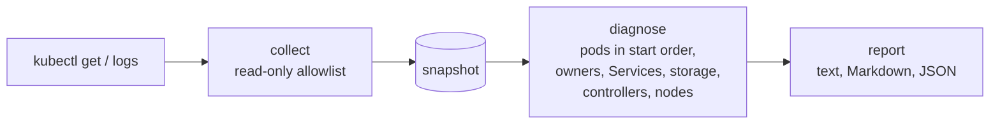

# kube-diagnose

[](https://github.com/sunilmehta-si/kube-diagnose/actions/workflows/ci.yml) [](https://github.com/sunilmehta-si/kube-diagnose/actions/workflows/faults.yml)

**Why is this Kubernetes workload broken?** kube-diagnose reads a namespace and answers with the root cause, the
object to change, the evidence the answer rests on, and for each piece of evidence the read-only `kubectl` command
that shows it to you. It never changes anything: every kubectl command it runs is `get`, `logs` or `version`.

```text
$ kubectl diagnose -n kd-liveness-wrong-port
kube-diagnose · context kind-kd-faults · namespace kd-liveness-wrong-port · 2026-11-16 05:34 UTC
1 problem: 1 warning.

1. WARNING  Liveness probe kills the container  KD112
   Deployment kd-liveness-wrong-port/web
   Cause: container web fails its liveness probe (GET / on port 9090, but the container declares
          port 8080), so the kubelet restarts it (5 restarts); Deployment web has 1 of 1 replicas
          ready
   Evidence:
     [1] Pod kd-liveness-wrong-port/web-67fbcb44db-4wjdg: event Unhealthy (6 times)
         │ Liveness probe failed: Get "http://10.244.0.26:9090/": dial tcp 10.244.0.26:9090: connect: connection refused
         $ kubectl get events -n kd-liveness-wrong-port --field-selector involvedObject.kind=Pod,involvedObject.name=web-67fbcb44db-4wjdg
     [2] Pod kd-liveness-wrong-port/web-67fbcb44db-4wjdg: event Killing (6 times)
         │ Container web failed liveness probe, will be restarted
         $ kubectl get events -n kd-liveness-wrong-port --field-selector involvedObject.kind=Pod,involvedObject.name=web-67fbcb44db-4wjdg
   Fix: Point the probe at a port and path the app serves, or give it a startupProbe or longer
        initialDelaySeconds if it starts slowly.
   Affects: Pod web-67fbcb44db-4wjdg
```

That is a real run: the [fault suite](#the-fault-suite)'s recording of a Deployment whose liveness probe checks the
wrong port, on kind ([`testdata/faults`](testdata/faults)). A test keeps this block identical to what the code prints for that recording.

## What it does differently

- **One root cause per problem, not one line per symptom.** A pod is checked in the order it starts (scheduling,
  volumes and configuration, image, process, probes), so the first failure is the cause and the restarts, unready
  pods and empty Services after it are its symptoms. Three replicas failing the same way are one finding on their
  Deployment, where the fix goes, with the pods and the Services they break listed under it.
- **Evidence you can check.** Each finding cites the container states, events, log lines and object fields it
  rests on, each with the kubectl command that shows it. It never claims something is missing from a list it could
  not read: what RBAC hid is reported as a gap.
- **No AI needed, and nothing leaves your machine.** The diagnosis is deterministic code over what kubectl returns.
- **Read-only by construction.** All kubectl calls go through one allowlist ([`CheckReadOnly`](internal/collect/kubectl.go))
  that refuses anything but `get`, `logs`, `version` and two `config` reads, and the tests hold every command the
  tool prints as evidence to the same allowlist. Secrets are read as key names only, through a kubectl template, so
  their values never reach the process.
- **Measured against real broken clusters.** The [fault suite](#the-fault-suite) breaks a kind cluster in 84 ways on
  every push and scores kube-diagnose, k8sgpt and HolmesGPT by the same test.

It knows 102 rules ([docs/rules.md](docs/rules.md)): images that do not exist, cannot be pulled, are rate-limited, have
no build for the node's platform or are not on the node with pull policy Never, pull secrets that are missing or of
the wrong type, crashes (with the exit code explained and the log line that reads like the error quoted, and traced to
the Service the app could not resolve or reach, the port another container holds, the NetworkPolicy that blocks DNS or
drops the connection, the RBAC permission its ServiceAccount lacks, or the token automounting turned off),
out-of-memory kills, probes on the wrong port or running a command the image does not have, init containers that never
finish (sidecars are told apart), readiness gates nobody sets, failing lifecycle hooks, runAsNonRoot with a root
image, writes to a read-only root filesystem, missing ConfigMaps, Secrets and keys, pods no node can take (with the
request and the largest node's capacity, or the spread rule, host port, volume zone, scheduling gate or missing
scheduler that stops them), pod sandboxes the network plugin cannot set up, hostPath volumes the node does not have,
pods stuck terminating, volumes still attached to another node, claims for StorageClasses that do not exist, access
modes they cannot provide or a named volume they cannot bind to, Services and Ingresses that send traffic nowhere,
Ingress TLS Secrets that are missing, LoadBalancer Services that never get an address, StatefulSets without their
headless Service, NetworkPolicies that shut a Service off, exhausted quotas, LimitRange, PriorityClass, RuntimeClass,
ServiceAccount, Pod Security and webhook rejections, Deployments left paused, HPAs that cannot scale,
PodDisruptionBudgets that block drains or select nothing, evictions, failed Jobs and CronJobs, and nodes that are not
ready.

## Install

Download an archive for your platform from the [releases](https://github.com/sunilmehta-si/kube-diagnose/releases),
check it, and put both binaries on your PATH; `kubectl-diagnose` makes it a kubectl plugin:

```bash
gh attestation verify kube-diagnose-<version>-linux-amd64.tar.gz --repo sunilmehta-si/kube-diagnose
tar -xzf kube-diagnose-<version>-linux-amd64.tar.gz -C ~/.local/bin kube-diagnose kubectl-diagnose
```

Or build it: `go install github.com/sunilmehta-si/kube-diagnose/cmd/kube-diagnose@latest` (Go 1.27). It needs
kubectl on the PATH and uses your current context and credentials.

## Use

```bash
kubectl diagnose                       # the current namespace
kubectl diagnose -n shop               # one namespace
kubectl diagnose -A                    # every namespace
kubectl diagnose -n shop -o markdown   # for an issue or a pull request; -o json for tools
kubectl diagnose -n shop --fail-on warning   # exit 1 when something is wrong, for CI after a deploy
kubectl diagnose -n shop --ignore KD168      # leave out a rule's findings (here: no load balancers on kind)
kubectl diagnose record -n shop -o shop.snapshot.json.gz   # save what it read
kube-diagnose --snapshot shop.snapshot.json.gz           # diagnose it later, anywhere, without a cluster
kube-diagnose rules KD161              # what a rule detects and from which evidence
```

It needs permission to `get` and `list` pods, events, Services, EndpointSlices, Ingresses, workloads, Jobs, CronJobs,
HorizontalPodAutoscalers, PodDisruptionBudgets, claims, NetworkPolicies, ResourceQuotas, ServiceAccounts,
ConfigMaps and Secrets in the namespace, nodes, StorageClasses, IngressClasses and PersistentVolumes in the cluster,
and to read pod logs. With less, it diagnoses from the rest and lists what it could not read.

A snapshot holds object names, labels, event messages and log lines (never Secret or ConfigMap values) and is
written readable by you only; treat it like the cluster data it came from. To share one in an issue, record it with
`--redact`: names, label values, image repositories and IP addresses become pseudonyms, the context name and the
logs are dropped, and the redacted snapshot still diagnoses to the same causes (crash causes that only a log line
shows are lost with the logs).

## The fault suite

[`faults/`](faults) holds 84 broken namespaces and one healthy one. Each broken one is a manifest that breaks it in a
known way (an image tag that does not exist, a liveness probe on the wrong port, a Service selector that matches no
pod, a claim for a StorageClass that does not exist, a quota that is used up, an image built for another CPU
architecture, and more) and an `expect.json` with the words that name its root cause. On every push,
[`faults.yml`](.github/workflows/faults.yml) applies them all to a kind cluster, lets them run for two and a half
minutes, and runs each tool on each namespace:

- **kube-diagnose** as above, and it records each namespace's snapshot;
- **k8sgpt** `analyze` with its default analyzers and no AI backend, as installed;
- **HolmesGPT** `ask`, when the workflow is started by hand with a model and the repository has that provider's key.

A tool scores a fault when what it reported for that namespace contains the words that name the cause, fixed in
`expect.json` before any run: for the liveness probe, both "liveness" and the wrong port "9090". kube-diagnose is
judged on its titles and causes only, not on the evidence, which quotes the cluster's own messages. Findings on the
healthy namespace count as false alarms. The workflow's summary shows the table for each run; `hack/faults.sh` runs
the same suite on any machine with Docker and Go, on its own kind cluster, and `cmd/faultsuite` refuses any
kubeconfig context that is not kind-*.

The run committed in [`results/faults`](results/faults) ([run 43810509539](https://github.com/sunilmehta-si/kube-diagnose/actions/runs/43810509539),
16 November 2026, Kubernetes v1.37.0 on kind v0.33.0, k8sgpt v0.4.41):

| Tool | Named the root cause | In its first finding | False alarms on the healthy namespace | Other findings on the faults |
|---|---|---|---|---|
| kube-diagnose | 66 of 66 (exact rule and object: 66) | 66 | 0 | 0 |
| k8sgpt | 29 of 66 | 12 | 0 | 106 |
| holmesgpt | not run | | | |

| Scenario | Fault | kube-diagnose | k8sgpt | holmesgpt |
|---|---|---|---|---|
| bad-image-tag | A Deployment's image tag does not exist. | ✅ | ☑️ | – |
| command-not-found | The container's command is not in the image. | ✅ | ☑️ | – |
| crashloop-missing-env | The app exits because an environment variable it needs is not set. | ✅ | ❌ | – |
| cronjob-fails | A CronJob runs every minute and every run fails because BACKUP_TARGET is not set. | ✅ | ❌ | – |
| csi-driver-missing | A database's volume belongs to a CSI driver that is registered in the API but runs on no node, so the volume never mounts and the pod stays in ContainerCreating. | ✅ | ☑️ | – |
| deployment-paused | A Deployment was created paused and never resumed, so it has no ReplicaSet and no pods, and nothing reports an error. | ✅ | ❌ | – |
| device-plugin-missing | A Deployment's pods request an extended resource that no node advertises, because no device plugin provides it, so they stay Pending. | ✅ | ❌ | – |
| dns-missing-service | An app calls a Service named payments that does not exist; the lookup fails and it exits. | ✅ | ❌ | – |
| ephemeral-storage-limit | A container writes 50 MiB to its local disk with a 10 MiB ephemeral-storage limit and is evicted. | ✅ | ✅ | – |
| exec-format-error | The image is built for arm64 and the node is amd64 (CI's runners are amd64). | ✅ | ❌ | – |
| healthy | Control: a working Deployment and Service. Every finding here is a false alarm. | ✅ quiet | ✅ quiet | – |
| hostpath-missing | A DaemonSet mounts a hostPath of type Directory that the nodes do not have, so its pods stay in ContainerCreating. | ✅ | ☑️ | – |
| hostport-conflict | Two replicas ask for the same hostPort on a one-node cluster, so the second is never scheduled. | ✅ | ❌ | – |
| hpa-no-metrics | An HPA scales on CPU utilization in a cluster without a metrics API, so it never scales. | ✅ | ❌ | – |
| hpa-target-missing | An HPA targets a Deployment that does not exist. | ✅ | ❌ | – |
| image-never-pull | A Deployment's image is not on the node and its imagePullPolicy is Never, so the kubelet will not pull it. | ✅ | ☑️ | – |
| image-wrong-platform | A Deployment's image is published only for arm64, and the node is amd64, so there is no build to pull. | ✅ | ☑️ | – |
| ingress-class-missing | An Ingress asks for an IngressClass that does not exist, so no controller serves it. | ✅ | ✅ | – |
| ingress-missing-service | An Ingress sends traffic to a Service that does not exist. | ✅ | ✅ | – |
| ingress-scaled-to-zero | An Ingress routes to a Service whose Deployment is scaled to 0 replicas, so every request fails. | ✅ | ❌ | – |
| ingress-tls-secret-missing | An Ingress serves TLS from a Secret that does not exist, so the controller would serve its default certificate. | ✅ | ✅ | – |
| ingress-wrong-port | An Ingress sends traffic to port 8080 of a Service that exposes port 80. | ✅ | ❌ | – |
| init-container-fails | An init container fails, so the app never starts. | ✅ | ❌ | – |
| init-never-finishes | An init container waits for a database Service that does not exist, so the app never starts and nothing reports an error. | ✅ | ❌ | – |
| insufficient-cpu | A pod requests more CPU than any node has. | ✅ | ✅ | – |
| job-backoff | A Job's container fails until the Job hits its backoff limit. | ✅ | ❌ | – |
| job-suspended | A Job was created suspended and never resumed, so it runs no pods and reports no error. | ✅ | ✅ | – |
| limitrange-max-memory | A LimitRange caps containers at 64 MiB and the Deployment asks for a 128 MiB limit, so no pod is created. | ✅ | ☑️ | – |
| liveness-wrong-port | The liveness probe checks a port nothing listens on, so the kubelet keeps restarting a healthy server. | ✅ | ❌ | – |
| loadbalancer-pending | A Service of type LoadBalancer on a cluster with no load balancer implementation never gets an external address. | ✅ | ❌ | – |
| missing-configmap-env | A container's envFrom names a ConfigMap that does not exist. | ✅ | ☑️ | – |
| missing-configmap-volume | A volume mounts a ConfigMap that does not exist, so the pod never starts. | ✅ | ☑️ | – |
| missing-repository | A Deployment's image is in a repository that does not exist; the registry answers 403 denied. | ✅ | ☑️ | – |
| missing-scheduler | Pods name a scheduler (volcano) that is not installed, so nothing ever schedules them. | ✅ | ❌ | – |
| missing-secret-key | A container reads a key the Secret does not have. | ✅ | ☑️ | – |
| missing-serviceaccount | Pods run as a ServiceAccount that does not exist, so none is created. | ✅ | ☑️ | – |
| networkpolicy-blocks-dns | An egress NetworkPolicy allows the app to reach only its database, which also blocks DNS, so the app cannot resolve the database's name and exits. | ✅ | ❌ | – |
| networkpolicy-blocks-service | An egress NetworkPolicy lets the app resolve names but reach nothing else, so its connection to the db Service times out and it exits. | ✅ | ❌ | – |
| networkpolicy-deny-all | A default-deny NetworkPolicy shuts off a Service's pods. | ✅ | ❌ | – |
| node-selector | A pod's nodeSelector matches no node. | ✅ | ❌ | – |
| oomkilled | A container uses more memory than its limit. | ✅ | ✅ | – |
| pdb-blocks-drain | A PodDisruptionBudget keeps 1 of 1 replica available, so draining its node never finishes. | ✅ | ❌ | – |
| pdb-selects-nothing | A PodDisruptionBudget selects app=frontend while the pods are app=web, so it protects nothing. | ✅ | ❌ | – |
| pod-anti-affinity | Two replicas require different nodes (pod anti-affinity) on a one-node cluster, so the second is never scheduled. | ✅ | ✅ | – |
| pod-security-restricted | The namespace enforces the restricted Pod Security level and the pods do not meet it. | ✅ | ☑️ | – |
| port-in-use | A sidecar listens on the same port as the app in the same pod, so it exits with address in use. | ✅ | ❌ | – |
| poststart-hook-fails | A postStart hook runs a script that is not in the image, so the kubelet kills the container each time it starts. | ✅ | ❌ | – |
| priorityclass-missing | Pods name a PriorityClass that does not exist, so none is created. | ✅ | ☑️ | – |
| probe-command-missing | A liveness probe runs curl, which the busybox image does not have, so every probe errors and the kubelet ignores it: the container runs with a liveness check that checks nothing. | ✅ | ❌ | – |
| pull-secret-missing | A private image is pulled with an imagePullSecret that does not exist. | ✅ | ❌ | – |
| pull-secret-wrong-type | A private image is pulled with an imagePullSecret of type Opaque, which the kubelet ignores. | ✅ | ❌ | – |
| pv-reserved-elsewhere | A claim names a PersistentVolume that is reserved for another claim, so it stays Pending with no event, and the database that mounts it never starts. | ✅ | ❌ | – |
| pvc-access-mode | A claim asks for ReadWriteMany from kind's default StorageClass, whose node-local provisioner supports only ReadWriteOnce. | ✅ | ❌ | – |
| pvc-missing-storageclass | A claim asks for a StorageClass that does not exist, and the pod waits for it. | ✅ | ☑️ | – |
| quota-exceeded | A ResourceQuota allows one pod and the Deployment wants three. | ✅ | ✅ | – |
| readiness-failing | The readiness probe asks for a path the server does not have, so the pods never get traffic. | ✅ | ☑️ | – |
| readiness-gate-unset | A Deployment's pods have a readiness gate that no controller in the cluster sets, so they run with every container ready but never become Ready, and their Service has no endpoints. | ✅ | ❌ | – |
| readonly-root-filesystem | A container with a read-only root filesystem creates a directory in it at start and exits. | ✅ | ❌ | – |
| runasnonroot-root-image | The pod requires a non-root user and the image runs as root, so the container is never created. | ✅ | ✅ | – |
| runtimeclass-missing | A Deployment's pods name a RuntimeClass the cluster does not have, so admission rejects every pod and none is created. | ✅ | ☑️ | – |
| scheduling-gate | A Deployment's pods carry a scheduling gate that no controller removes, so they stay Pending with no events and no error. | ✅ | ❌ | – |
| service-port-name | A Service's targetPort names a port the container does not declare. | ✅ | ❌ | – |
| service-refused | An app connects to Service db, whose Deployment is scaled to 0, so the connection is refused and the app exits. | ✅ | ❌ | – |
| service-selector-mismatch | A Service selects app=web while its pods are labelled app=webapp. | ✅ | ✅ | – |
| service-wrong-target-port | A Service sends traffic to port 80, but the container listens on 8080. | ✅ | ❌ | – |
| statefulset-missing-service | A StatefulSet names a governing Service that does not exist, so its pods have no DNS names. | ✅ | ✅ | – |
| token-not-mounted | A controller reads its ServiceAccount token at start, but its ServiceAccount turns token automounting off, so the token is never mounted and the container exits. | ✅ | ❌ | – |

✅ named the root cause in its first finding · ☑️ named it, but not first · ❌ did not name it · ⚠️ N: N false alarms · – not run

k8sgpt reports what each of its analyzers sees: the symptom where kube-diagnose names the cause behind it. For the
crash it said only that the last termination reason is Error, not that the log says DATABASE_URL is not set; for the
liveness probe on the wrong port it reported nothing in this run, since it looked while the container was running
between restarts (in the 0.2.0 run it said only that the last termination reason is Error; k8sgpt-ai/k8sgpt#1941
proposes reporting the probe); for the node selector it quoted the scheduler's message, not which label no node has; and for the
deny-all NetworkPolicy its default analyzers reported nothing (its NetworkPolicy analyzer is not on by default). The first run of this suite, before a fix,
caught kube-diagnose missing 4 of the 23: containers that had just exited, which the kubelet had not yet marked as
crash-looping. The first runs of the 0.2.0 scenarios caught two message forms the unit tests had not seen: a
postStart failure event that does not name the hook, and an eviction message that ends in a space. The 14 scenarios
added for 0.3.0 were named first, with the exact rule and object, on their first run. The 12 added for 0.4.0 caught
three things the unit tests had not: an exec probe whose command is not in the image errors without restarting the
container, so it checks nothing (KD129 was added for it); the kubelet writes a comma in its hostPath type check
message; and once the runtime reported an out-of-memory kill as exit 137 with reason Error. Each recorded namespace is also in [`testdata/faults`](testdata/faults), and `make test` replays all of
them through the current code.

## How it works



A diagnosis is a pure function of a snapshot, which is why the tests run on recorded clusters and why `record` and
`--snapshot` give the same answer as a live run. The code has no dependencies outside the Go standard library.

## Contributing

See [CONTRIBUTING.md](CONTRIBUTING.md); to report a vulnerability, [SECURITY.md](SECURITY.md). Apache-2.0.
