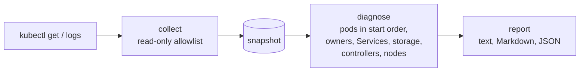

# kube-diagnose

[](https://github.com/sunilmehta-si/kube-diagnose/actions/workflows/ci.yml) [](https://github.com/sunilmehta-si/kube-diagnose/actions/workflows/faults.yml)

**Why is this Kubernetes workload broken?** kube-diagnose reads a namespace and answers with the root cause, the
object to change, the evidence the answer rests on, and for each piece of evidence the read-only `kubectl` command
that shows it to you. It never changes anything: every kubectl command it runs is `get`, `logs` or `version`.

```text
$ kubectl diagnose -n shop
kube-diagnose · context kind-example · namespace shop · 2026-11-13 10:00 UTC
1 problem: 1 critical.

1. CRITICAL  Liveness probe kills the container  KD112
   Deployment shop/web
   Cause: container web fails its liveness probe (GET /healthz on port 9090, but the container
          declares port 8080), so the kubelet restarts it (7 restarts); Deployment web has 0 of 2
          replicas ready
   Evidence:
     [1] Pod shop/web-7d9c5b-4kq2x: event Unhealthy (8 times)
         │ Liveness probe failed: Get "http://10.244.0.12:9090/healthz": dial tcp 10.244.0.12:9090: connect: connection refused
         $ kubectl get events -n shop --field-selector involvedObject.kind=Pod,involvedObject.name=web-7d9c5b-4kq2x
     [2] Pod shop/web-7d9c5b-4kq2x: event Killing (7 times)
         │ Container web failed liveness probe, will be restarted
         $ kubectl get events -n shop --field-selector involvedObject.kind=Pod,involvedObject.name=web-7d9c5b-4kq2x
   Fix: Point the probe at a port and path the app serves, or give it a startupProbe or longer
        initialDelaySeconds if it starts slowly.
   Affects: Pods web-7d9c5b-4kq2x, web-7d9c5b-r8m7t; Service web
```

That example is [`testdata/example.snapshot.json`](testdata/example.snapshot.json), a recording of a Deployment whose
liveness probe checks the wrong port; a test keeps this block identical to what the code prints for it.

## What it does differently

- **One root cause per problem, not one line per symptom.** A pod is checked in the order it starts (scheduling,
  volumes and configuration, image, process, probes), so the first failure is the cause and the restarts, unready
  pods and empty Services after it are its symptoms. Three replicas failing the same way are one finding on their
  Deployment, where the fix goes, with the pods and the Services they break listed under it.
- **Evidence you can check.** Each finding cites the container states, events, log lines and object fields it
  rests on, each with the kubectl command that shows it. It never claims something is missing from a list it could
  not read: what RBAC hid is reported as a gap.
- **No AI needed, and nothing leaves your machine.** The diagnosis is deterministic code over what kubectl returns.
- **Read-only by construction.** All kubectl calls go through one allowlist ([`CheckReadOnly`](internal/collect/kubectl.go))
  that refuses anything but `get`, `logs`, `version` and two `config` reads, and the tests hold every command the
  tool prints as evidence to the same allowlist. Secrets are read as key names only, through a kubectl template, so
  their values never reach the process.
- **Measured against real broken clusters.** The [fault suite](#the-fault-suite) breaks a kind cluster in 23 ways on
  every push and scores kube-diagnose, k8sgpt and HolmesGPT by the same test.

It knows 41 rules ([docs/rules.md](docs/rules.md)): images that do not exist or cannot be pulled, crashes (with the
exit code explained and the log line that reads like the error quoted), out-of-memory kills, probes on the wrong port,
missing ConfigMaps, Secrets and keys, pods no node can take (with the request and the largest node's capacity),
claims for StorageClasses that do not exist, Services that select nothing or target a port the pods do not have,
NetworkPolicies that shut a Service off, exhausted quotas, missing ServiceAccounts, Pod Security and webhook
rejections, failed Jobs, and nodes that are not ready.

## Install

Download an archive for your platform from the [releases](https://github.com/sunilmehta-si/kube-diagnose/releases),
check it, and put both binaries on your PATH; `kubectl-diagnose` makes it a kubectl plugin:

```bash
gh attestation verify kube-diagnose-<version>-linux-amd64.tar.gz --repo sunilmehta-si/kube-diagnose
tar -xzf kube-diagnose-<version>-linux-amd64.tar.gz -C ~/.local/bin kube-diagnose kubectl-diagnose
```

Or build it: `go install github.com/sunilmehta-si/kube-diagnose/cmd/kube-diagnose@latest` (Go 1.27). It needs
kubectl on the PATH and uses your current context and credentials.

## Use

```bash
kubectl diagnose                       # the current namespace
kubectl diagnose -n shop               # one namespace
kubectl diagnose -A                    # every namespace
kubectl diagnose -n shop -o markdown   # for an issue or a pull request; -o json for tools
kubectl diagnose -n shop --fail-on warning   # exit 1 when something is wrong, for CI after a deploy
kubectl diagnose record -n shop -o shop.snapshot.json.gz   # save what it read
kube-diagnose --snapshot shop.snapshot.json.gz           # diagnose it later, anywhere, without a cluster
kube-diagnose rules KD161              # what a rule detects and from which evidence
```

It needs permission to `get` and `list` pods, events, Services, EndpointSlices, workloads, Jobs, claims,
NetworkPolicies, ResourceQuotas, ServiceAccounts, ConfigMaps and Secrets in the namespace, nodes, StorageClasses
and PersistentVolumes in the cluster, and to read pod logs. With less, it diagnoses from the rest and lists what
it could not read.

A snapshot holds object names, labels, event messages and log lines (never Secret or ConfigMap values) and is
written readable by you only; treat it like the cluster data it came from.

## The fault suite

[`faults/`](faults) holds 23 broken namespaces and one healthy one. Each broken one is a manifest that breaks it in a
known way (an image tag that does not exist, a liveness probe on the wrong port, a Service selector that matches no
pod, a claim for a StorageClass that does not exist, a quota that is used up, an image built for another CPU
architecture, and more) and an `expect.json` with the words that name its root cause. On every push,
[`faults.yml`](.github/workflows/faults.yml) applies them all to a kind cluster, lets them run for two and a half
minutes, and runs each tool on each namespace:

- **kube-diagnose** as above, and it records each namespace's snapshot;
- **k8sgpt** `analyze` with its default analyzers and no AI backend, as installed;
- **HolmesGPT** `ask`, when the workflow is started by hand with a model and the repository has that provider's key.

A tool scores a fault when what it reported for that namespace contains the words that name the cause, fixed in
`expect.json` before any run: for the liveness probe, both "liveness" and the wrong port "9090". kube-diagnose is
judged on its titles and causes only, not on the evidence, which quotes the cluster's own messages. Findings on the
healthy namespace count as false alarms. The workflow's summary shows the table for each run; `hack/faults.sh` runs
the same suite on any machine with Docker and Go, on its own kind cluster, and `cmd/faultsuite` refuses any
kubeconfig context that is not kind-*.

## How it works



A diagnosis is a pure function of a snapshot, which is why the tests run on recorded clusters and why `record` and
`--snapshot` give the same answer as a live run. The code has no dependencies outside the Go standard library.

## Contributing

See [CONTRIBUTING.md](CONTRIBUTING.md); to report a vulnerability, [SECURITY.md](SECURITY.md). Apache-2.0.
