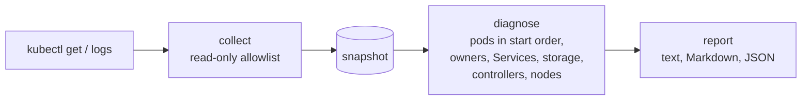

# kube-diagnose

[](https://github.com/sunilmehta-si/kube-diagnose/actions/workflows/ci.yml) [](https://github.com/sunilmehta-si/kube-diagnose/actions/workflows/faults.yml)

**Why is this Kubernetes workload broken?** kube-diagnose reads a namespace and answers with the root cause, the
object to change, the evidence the answer rests on, and for each piece of evidence the read-only `kubectl` command
that shows it to you. It never changes anything: every kubectl command it runs is `get`, `logs` or `version`.

```text
$ kubectl diagnose -n kd-liveness-wrong-port
kube-diagnose · context kind-kd-faults · namespace kd-liveness-wrong-port · 2026-11-24 11:19 UTC
1 problem: 1 critical.

1. CRITICAL  Liveness probe kills the container  KD112
   Deployment kd-liveness-wrong-port/web
   Cause: container web fails its liveness probe (GET / on port 9090, but the container declares
          port 8080), so the kubelet restarts it (6 restarts); Deployment web has 0 of 1 replicas
          ready
   Evidence:
     [1] Pod kd-liveness-wrong-port/web-67fbcb44db-vn57z: event Unhealthy (7 times)
         │ Liveness probe failed: Get "http://10.244.0.79:9090/": dial tcp 10.244.0.79:9090: connect: connection refused
         $ kubectl get events -n kd-liveness-wrong-port --field-selector involvedObject.kind=Pod,involvedObject.name=web-67fbcb44db-vn57z
     [2] Pod kd-liveness-wrong-port/web-67fbcb44db-vn57z: event Killing (6 times)
         │ Container web failed liveness probe, will be restarted
         $ kubectl get events -n kd-liveness-wrong-port --field-selector involvedObject.kind=Pod,involvedObject.name=web-67fbcb44db-vn57z
   Fix: Point the probe at a port and path the app serves, or give it a startupProbe or longer
        initialDelaySeconds if it starts slowly.
   Affects: Pod web-67fbcb44db-vn57z
```

That is a real run: the [fault suite](#the-fault-suite)'s recording of a Deployment whose liveness probe checks the
wrong port, on kind ([`testdata/faults`](testdata/faults)). A test keeps this block identical to what the code prints for that recording.

## What it does differently

- **One root cause per problem, not one line per symptom.** A pod is checked in the order it starts (scheduling,
  volumes and configuration, image, process, probes), so the first failure is the cause and the restarts, unready
  pods and empty Services after it are its symptoms. Three replicas failing the same way are one finding on their
  Deployment, where the fix goes, with the pods and the Services they break listed under it.
- **Evidence you can check.** Each finding cites the container states, events, log lines and object fields it
  rests on, each with the kubectl command that shows it. It never claims something is missing from a list it could
  not read: what RBAC hid is reported as a gap.
- **No AI needed, and nothing leaves your machine.** The diagnosis is deterministic code over what kubectl returns.
- **Read-only by construction.** All kubectl calls go through one allowlist ([`CheckReadOnly`](internal/collect/kubectl.go))
  that refuses anything but `get`, `logs`, `version` and two `config` reads, and the tests hold every command the
  tool prints as evidence to the same allowlist. Secrets are read as key names only, through a kubectl template, so
  their values never reach the process.
- **Measured against real broken clusters.** The [fault suite](#the-fault-suite) breaks a kind cluster in 214 ways on
  every push and scores kube-diagnose, k8sgpt and HolmesGPT by the same test.

It knows 214 rules ([docs/rules.md](docs/rules.md)): images that do not exist, cannot be pulled, are rate-limited, have
no build for the node's platform or are not on the node with pull policy Never, pull secrets that are missing or of the
wrong type, commands written as one string, a flag and its value written as one argument, flags written under command
where args is meant, scripts whose interpreter the image does not have or that were saved with Windows line endings,
commands using a $(VARIABLE) the container does not define or the shell's $VARIABLE or an operator such as && with no
shell, env values that refer to a variable defined after them, volumes mounted over the command, Localhost seccomp
profiles the node does not have, memory limits without a unit (memory: 512 is bytes), RuntimeClasses whose handler the
node's runtime lacks, crashes (with the exit code explained and the log line that reads like the error quoted, and
traced to the Service the app could not resolve or reach, the localhost address it used for a Service in another pod,
the port the Service does not expose, the Service whose ready pods do not listen on the port it targets, the service
link variable that replaced its own setting, the path of its image that a non-root user may not write, the Linux
capability its securityContext drops, the DNS policy that sends its lookups to the node's resolver or to nameservers
that are not cluster DNS, the ExternalName Service whose name does not resolve, the volume it may not write to or that
is read-only, the file its ConfigMap volume does not have, the script mounted without an executable mode, the port
another container or, on the host network, the node itself holds, the NetworkPolicy that blocks DNS or drops the
connection, the RBAC permission its ServiceAccount lacks, the Role that grants the resource in another API group, under
a misspelled name, without the verb or the subresource (pods/log) or only by resourceNames for a list, the permission
granted in another namespace or by a RoleBinding for a cluster-wide request or to another ServiceAccount than the pod's,
the RoleBinding that names a Role or a ServiceAccount that does not exist, the IP address it was given in place of the
Service's name, the optional key or pod label whose absence left a variable unset, the file its init container wrote
where it mounts the volume elsewhere, the key file whose mode lets others read it, the user ID its image's /etc/passwd
lacks, the ConfigMap mounted as a directory where it reads a file, or the token automounting turned off), out-of-memory
kills (a memory-backed emptyDir, a LimitRange's default limit and the app's own memory setting above the limit among
them), probes on the wrong port, speaking HTTPS to plain HTTP, checking a host other than the pod, refused because the
app listens on localhost only, gRPC probes on a port that does not speak gRPC or lacks the health service, liveness
probes that kill the app before it has started, probes that time out, preStop hooks that outlast the grace period,
readiness probes held back by a long initialDelaySeconds, naming a port the container does not have or running a command
the image does not have or one written as a single string (a failed HTTP probe's status, 404 or 401 say, is explained),
init containers that never finish (sidecars are told apart, and one that waits for its own pod's Service is named),
readiness gates nobody sets, failing lifecycle hooks, runAsNonRoot with a root image, writes to a read-only root
filesystem, missing ConfigMaps, Secrets and keys, subPaths that name a key the volume does not have, pods no node can
take (with the request and the largest node's capacity, a cpu request missing its m, or the spread rule, a spread over a
node label no node has or with more minDomains than the nodes form, pod affinity to pods that do not exist, node
affinity no node meets, host port, volume zone, scheduling gate, missing scheduler or ReadWriteOncePod claim another pod
holds that stops them), pods the kubelet rejects for a sysctl it forbids or a resource the node lacks, or, when
spec.nodeName skips the scheduler, for the node's labels or a host port another pod holds, pods for another operating
system, pods stopped at their activeDeadlineSeconds, pod sandboxes the network plugin cannot set up, hostPath volumes
the node does not have (the Docker socket on a containerd node among them), pods bound by nodeName to a node that does
not exist or past the scheduler their claim waits for, pods stuck terminating, volumes still attached to another node,
claims for StorageClasses that do not exist, access modes they cannot provide or a named volume they cannot bind to,
claims that no hand-made PersistentVolume fits (too small, other access modes, taken, or Released), claims that have
lost their volume or carry a selector their provisioner refuses, Services and Ingresses that send traffic nowhere,
Services with no selector and no endpoints (or an EndpointSlice missing the label that links it), headless Services that
map a port nothing maps, Service ports whose protocol the pods do not serve, Services that also select another
workload's pods, pod subdomains no headless Service serves, ExternalName Services set to an IP address, Ingresses that
claim one host and path for different Services, Ingress TLS Secrets that are missing, Ingress hosts their TLS does not
cover, Gateway API routes that send traffic to a Service or port that does not exist or to another namespace that grants
them nothing, are attached to no Gateway, to one or a listener that does not exist, to listeners that do not admit them
or serve none of their hostnames, or tie with an older route for a hostname and path, Gateways whose GatewayClass or
listener certificate Secret does not exist, LoadBalancer Services that never get an address, StatefulSets without their
headless Service, NetworkPolicies that shut a Service off, cut pods off from the API server, allow the Service's port
where the pods' port is meant, allow a Service's cluster IP by ipBlock, allow a port name the pods do not declare,
select no pods or select namespaces by a label none has, exhausted quotas, quotas on a limit the pods do not set, a
LimitRange default below the container's request, LimitRange, PriorityClass, RuntimeClass, ServiceAccount, Pod Security
and webhook rejections, admission webhooks that cannot be reached, Deployments left paused or holding ready pods
unavailable with a long minReadySeconds, HPAs that cannot scale, name their target with an apiVersion the cluster does
not serve, are switched off by a target at 0 replicas or share their pods with another HPA, PodDisruptionBudgets that
block drains, select nothing or overlap, evictions (an emptyDir past its sizeLimit among them), failed Jobs and CronJobs
(a podFailurePolicy that failed the Job at once and a Job cut off by its activeDeadlineSeconds are named), replicas
sharing a ReadWriteOnce claim, CronJobs that skip runs, are suspended, replace each run before it finishes pile up runs,
are scheduled for a date that never comes or miss every start for a startingDeadlineSeconds too short, DaemonSets that
match no node, Jobs with parallelism 0 or held open by a sidecar that never exits, and nodes that are not ready.

## Install

Download an archive for your platform from the [releases](https://github.com/sunilmehta-si/kube-diagnose/releases),
check it, and put both binaries on your PATH; `kubectl-diagnose` makes it a kubectl plugin:

```bash
gh attestation verify kube-diagnose-<version>-linux-amd64.tar.gz --repo sunilmehta-si/kube-diagnose
tar -xzf kube-diagnose-<version>-linux-amd64.tar.gz -C ~/.local/bin kube-diagnose kubectl-diagnose
```

Or build it: `go install github.com/sunilmehta-si/kube-diagnose/cmd/kube-diagnose@latest` (Go 1.27). It needs
kubectl on the PATH and uses your current context and credentials.

## Use

```bash
kubectl diagnose                       # the current namespace
kubectl diagnose -n shop               # one namespace
kubectl diagnose -A                    # every namespace
kubectl diagnose -n shop -o markdown   # for an issue or a pull request; -o json for tools
kubectl diagnose -n shop --fail-on warning   # exit 1 when something is wrong, for CI after a deploy
kubectl diagnose -n shop --ignore KD168      # leave out a rule's findings (here: no load balancers on kind)
kubectl diagnose record -n shop -o shop.snapshot.json.gz   # save what it read
kube-diagnose --snapshot shop.snapshot.json.gz           # diagnose it later, anywhere, without a cluster
kube-diagnose rules KD161              # what a rule detects and from which evidence
kube-diagnose rules cronjob            # the rules that mention every word given
kube-diagnose rules KD14               # a range: KD14 is scheduling (docs/rules.md lists the ranges)
```

It needs permission to `get` and `list` pods, events, Services, EndpointSlices, Ingresses, workloads, Jobs, CronJobs,
HorizontalPodAutoscalers, PodDisruptionBudgets, claims, NetworkPolicies, ResourceQuotas, ServiceAccounts, Roles,
RoleBindings, ConfigMaps and Secrets in the namespace, nodes, StorageClasses, IngressClasses, PersistentVolumes,
namespaces (their names and labels) and ClusterRoles (their names) in the cluster, and to read pod logs. Where the
cluster serves the Gateway API, it also reads Gateways, HTTPRoutes, GRPCRoutes and ReferenceGrants in the namespace
and GatewayClasses in the cluster; a cluster without it is no gap. With less, it diagnoses from the rest and lists what it could not read.

A snapshot holds object names, labels, event messages and log lines (never Secret or ConfigMap values) and is
written readable by you only; treat it like the cluster data it came from. To share one in an issue, record it with
`--redact`: names, label values, image repositories and IP addresses become pseudonyms, the context name and the
logs are dropped, and the redacted snapshot still diagnoses to the same causes (crash causes that only a log line
shows are lost with the logs).

## The fault suite

[`faults/`](faults) holds 214 broken namespaces and one healthy one. Each broken one is a manifest that breaks it in a
known way (an image tag that does not exist, a liveness probe on the wrong port, a Service selector that matches no
pod, a claim for a StorageClass that does not exist, a quota that is used up, an image built for another CPU
architecture, and more) and an `expect.json` with the words that name its root cause. On every push,
[`faults.yml`](.github/workflows/faults.yml) applies them all to a kind cluster, lets them run for two and a half
minutes, and runs each tool on each namespace:

- **kube-diagnose** as above, and it records each namespace's snapshot;
- **k8sgpt** `analyze` with its default analyzers and no AI backend, as installed;
- **HolmesGPT** `ask`, when the workflow is started by hand with a model and the repository has that provider's key.

A tool scores a fault when what it reported for that namespace contains the words that name the cause, fixed in
`expect.json` before any run: for the liveness probe, both "liveness" and the wrong port "9090". kube-diagnose is judged
on its titles and causes only, not on the evidence, which quotes the cluster's own messages. The namespace's own name is
taken out of what a tool reported before it is judged: each namespace is named for its fault (kd-oomkilled), so a tool
that only repeats that name, as in the path of an object it lists, has named nothing. Findings on the healthy namespace
count as false alarms. The workflow's summary shows the table for each run; `hack/faults.sh` runs the same suite on any
machine with Docker and Go, on its own kind cluster, and `cmd/faultsuite` refuses any kubeconfig context that is not
kind-*.

The run committed in [`results/faults`](results/faults) ([run 45381548969](https://github.com/sunilmehta-si/kube-diagnose/actions/runs/45381548969),
24 November 2026, Kubernetes v1.37.0 on kind v0.33.0, k8sgpt v0.4.41):

| Tool | Named the root cause | In its first finding | False alarms on the healthy namespace | Other findings on the faults |
|---|---|---|---|---|
| kube-diagnose | 201 of 201 (exact rule and object: 201) | 201 | 0 | 0 |
| k8sgpt | 36 of 201 | 9 | 0 | 325 |
| holmesgpt | not run | | | |

| Scenario | Fault | kube-diagnose | k8sgpt | holmesgpt |
|---|---|---|---|---|
| app-listens-on-localhost | A web server is started with -p 127.0.0.1:8080, as on a laptop; in a pod that address is reachable only from the pod itself, so the kubelet's readiness probe is refused and the pod never becomes ready. | ✅ | ❌ | – |
| bad-image-tag | A Deployment's image tag does not exist. | ✅ | ☑️ | – |
| cache-size-above-limit | The cache is configured with CACHE_SIZE_MB=128 and fills it at start, and its memory limit is 64Mi, so it is OOMKilled every time. | ✅ | ❌ | – |
| capability-dropped | A container drops ALL capabilities, as the restricted Pod Security standard asks, but its start script chowns a cache directory; root without CAP_CHOWN is refused, so the container exits at every start. | ✅ | ❌ | – |
| command-not-found | The container's command is not in the image. | ✅ | ☑️ | – |
| command-one-string | A Deployment's command is one string, "sleep 3600", so the runtime looks for an executable with that whole name and cannot start the container. | ✅ | ❌ | – |
| command-shell-operator-no-shell | A command is written as a list, echo starting && sleep 3600, with no shell: && is one more argument to echo, which prints it and exits, so sleep never runs and the container restarts forever. | ✅ | ❌ | – |
| command-shell-var-no-shell | A Deployment runs ["sleep", "$SLEEP_SECONDS"] with SLEEP_SECONDS in its env; there is no shell to expand $SLEEP_SECONDS, so sleep gets the literal text and exits. | ✅ | ❌ | – |
| command-undefined-var | A Deployment runs ["sleep", "$(SLEEP_SECONDS)"] but its env defines SLEEP_SECOND; the kubelet passes the literal $(SLEEP_SECONDS), and sleep exits on it. | ✅ | ❌ | – |
| configmap-command-missing | A container runs /scripts/start.sh from a ConfigMap volume whose key is run.sh, so the runtime cannot find the command. | ✅ | ❌ | – |
| configmap-file-missing | An app reads /etc/app/config.yaml, but its ConfigMap's key is config.yml, so the file is not in the volume and the app exits. | ✅ | ❌ | – |
| configmap-mounted-as-directory | ConfigMap app-config is mounted whole at /etc/app/config.yaml, the file the app reads, without subPath, so the path is a directory holding config.yaml and the app exits. | ✅ | ❌ | – |
| configmap-read-only | A container rewrites a file of the ConfigMap volume it mounts, which the kubelet always mounts read-only, so it exits. | ✅ | ❌ | – |
| cpu-request-no-millicores | A Deployment asks for cpu: 500, meaning half a core; without the m suffix it is 500 cores, which no node has, so the pod is never scheduled. | ✅ | ❌ | – |
| crashloop-missing-env | The app exits because an environment variable it needs is not set. | ✅ | ❌ | – |
| cronjob-fails | A CronJob runs every minute and every run fails because BACKUP_TARGET is not set. | ✅ | ❌ | – |
| cronjob-forbid-overlap | A CronJob runs every minute with concurrencyPolicy Forbid, and its first run never ends, so every later run is skipped. | ✅ | ❌ | – |
| cronjob-misses-starts | A CronJob runs every minute with startingDeadlineSeconds: 0, meant as no deadline; the controller always acts a moment after the scheduled time, so every run is missed (MissSchedule) and no Job ever starts. | ✅ | ❌ | – |
| cronjob-never-due | A CronJob is scheduled for midnight on 30 February; the API accepts the schedule, and the controller finds no next run and never starts a Job. | ✅ | ❌ | – |
| cronjob-replace-never-finishes | A CronJob runs every minute with concurrencyPolicy Replace, and each run takes an hour, so every run is deleted by the next before it can finish. | ✅ | ❌ | – |
| cronjob-runs-pile-up | A CronJob runs a report every minute with the default concurrencyPolicy, Allow, and each report takes an hour; every minute another run starts beside the ones still going, and they pile up. | ✅ | ❌ | – |
| cronjob-suspended | A CronJob is created with suspend: true, so it never starts a Job. | ✅ | ✅ | – |
| csi-driver-missing | A database's volume belongs to a CSI driver that is registered in the API but runs on no node, so the volume never mounts and the pod stays in ContainerCreating. | ✅ | ☑️ | – |
| daemonset-no-nodes | A DaemonSet's nodeSelector asks for disktype=ssd, which no node has, so it runs no pods and nothing reports an error. | ✅ | ❌ | – |
| deployment-paused | A Deployment was created paused and never resumed, so it has no ReplicaSet and no pods, and nothing reports an error. | ✅ | ❌ | – |
| device-plugin-missing | A Deployment's pods request an extended resource that no node advertises, because no device plugin provides it, so they stay Pending. | ✅ | ❌ | – |
| dns-missing-service | An app calls a Service named payments that does not exist; the lookup fails and it exits. | ✅ | ❌ | – |
| dnspolicy-default | A pod sets dnsPolicy Default, so it resolves with the node's DNS, cannot find the api Service, and exits. | ✅ | ❌ | – |
| dnspolicy-none | An app sets dnsPolicy None with a public nameserver and its company's search domain, to reach outside names; with None its resolv.conf has only those, so the payments Service does not resolve and the app exits. | ✅ | ❌ | – |
| docker-socket-on-containerd | The pod mounts /var/run/docker.sock as a hostPath of type Socket, and kind's node runs containerd, not Docker, so the socket does not exist and the pod stays in ContainerCreating. | ✅ | ❌ | – |
| downward-label-missing | APP_VERSION comes from the pod label app.kubernetes.io/version through the downward API, and the pods have no such label, so the variable is empty and the api exits. | ✅ | ❌ | – |
| emptydir-memory-oom | A container writes 64 MiB into a memory-backed emptyDir with a 32 MiB memory limit; tmpfs pages count against the limit, so it is OOMKilled, and the file outlives each restart. | ✅ | ❌ | – |
| emptydir-size-limit | A container writes 20 MiB into an emptyDir with a 10 MiB sizeLimit, so the kubelet evicts its pods. | ✅ | ❌ | – |
| endpointslice-unlabelled | A Service without a selector points at an outside database through an EndpointSlice written by hand, which lacks the kubernetes.io/service-name label; nothing links the slice to the Service, so the Service has no endpoints. | ✅ | ❌ | – |
| env-var-defined-later | A container's API_URL is built from $(API_HOST), but API_HOST is defined below it in the env list; the kubelet expands only variables defined earlier, so the app gets the literal text and fails to resolve it. | ✅ | ❌ | – |
| ephemeral-storage-limit | A container writes 50 MiB to its local disk with a 10 MiB ephemeral-storage limit and is evicted. | ✅ | ✅ | – |
| exec-format-error | The image is built for arm64 and the node is amd64 (CI's runners are amd64). | ✅ | ❌ | – |
| externalname-ip | An ExternalName Service points at an IP address, which cluster DNS turns into a CNAME that resolves to nothing. | ✅ | ❌ | – |
| externalname-unresolved | An app reaches its database through an ExternalName Service, db, that points at orders-db.invalid; the name does not resolve, so the CNAME cluster DNS answers with leads nowhere and the app exits. | ✅ | ❌ | – |
| flag-value-one-arg | A Deployment passes "--port 8080" as one item of args, so the server receives the flag and its value as a single argument, does not know a flag by that name, and exits. | ✅ | ❌ | – |
| flags-in-command | A Deployment puts its server flags under command, not args: command replaces the image entrypoint, so the runtime looks for a program named --port=8080 and the container never starts. | ✅ | ❌ | – |
| gateway-class-missing | Gateway public names GatewayClass nginx, and the cluster has no such class, so no controller takes it. | ✅ | ❌ | – |
| gateway-hostname-mismatch | HTTPRoute shop serves shop.example.com, and the Gateway listener serves *.store.example.com only. | ✅ | ❌ | – |
| gateway-listener-missing | HTTPRoute shop attaches to listener https of Gateway public, which has an http listener only. | ✅ | ❌ | – |
| gateway-namespace-not-allowed | The Gateway listener admits routes from namespaces labelled gateway-access=public, and the route namespace has no such label. | ✅ | ❌ | – |
| gateway-parent-missing | HTTPRoute shop attaches to Gateway shop-gateway, and the Gateway is called public. | ✅ | ❌ | – |
| gateway-route-conflict | HTTPRoutes shop and shop-canary both send shop.example.com to Gateway public, to different Services, and the older route wins the tie, so the canary gets no request. | ✅ | ❌ | – |
| gateway-route-no-parent | HTTPRoute shop has no parentRefs, so it is attached to no Gateway. | ✅ | ❌ | – |
| gateway-route-port | HTTPRoute shop sends traffic to port 8080 of Service storefront, the container port, and the Service exposes port 80. | ✅ | ❌ | – |
| gateway-route-service-missing | HTTPRoute shop sends traffic to Service storefront-v2, and the Service is called storefront. | ✅ | ❌ | – |
| gateway-tls-secret-missing | The https listener of Gateway public terminates TLS with Secret shop-tls, which does not exist. | ✅ | ❌ | – |
| headless-port-remap | A headless Service (clusterIP: None) maps port 80 to targetPort 8080 for web servers on 8080; with no proxy to map it, clients that dial peers:80 reach the pods on port 80 and are refused. | ✅ | ❌ | – |
| healthy | Control: a working Deployment and Service. Every finding here is a false alarm. | ✅ quiet | ✅ quiet | – |
| hostnetwork-dns | A pod on the host network keeps the default dnsPolicy, so it resolves with the node's DNS, cannot find the api Service, and exits. | ✅ | ❌ | – |
| hostnetwork-port-taken | The node agent runs on the host network and listens on 10250, which the kubelet holds on every node, so the bind fails and it exits. | ✅ | ❌ | – |
| hostpath-missing | A DaemonSet mounts a hostPath of type Directory that the nodes do not have, so its pods stay in ContainerCreating. | ✅ | ☑️ | – |
| hostport-conflict | Two replicas ask for the same hostPort on a one-node cluster, so the second is never scheduled. | ✅ | ❌ | – |
| hpa-no-metrics | An HPA scales on CPU utilization in a cluster without a metrics API, so it never scales. | ✅ | ❌ | – |
| hpa-target-missing | An HPA targets a Deployment that does not exist. | ✅ | ❌ | – |
| hpa-target-old-apiversion | The HPA's scaleTargetRef names Deployment web in apiVersion extensions/v1beta1, which the API has not served since Kubernetes 1.16, so the HPA cannot get the Deployment's scale and scales nothing. | ✅ | ❌ | – |
| hpa-target-scaled-to-zero | A Deployment under an HPA was scaled to 0 replicas; the HPA leaves a workload at zero alone, so it never comes back up, and the only sign is a condition on the HPA. | ✅ | ❌ | – |
| hpa-two-on-one-workload | Two HPAs scale the same Deployment, one on CPU and one on memory; the HPA controller does not act on pods that more than one HPA controls, so neither scales it. | ✅ | ❌ | – |
| image-never-pull | A Deployment's image is not on the node and its imagePullPolicy is Never, so the kubelet will not pull it. | ✅ | ☑️ | – |
| image-wrong-platform | A Deployment's image is published only for arm64, and the node is amd64, so there is no build to pull. | ✅ | ☑️ | – |
| ingress-class-missing | An Ingress asks for an IngressClass that does not exist, so no controller serves it. | ✅ | ✅ | – |
| ingress-host-without-tls | An Ingress has TLS for www.shop.example.com, but its rule serves shop.example.com, the name customers use; no TLS entry covers it, so HTTPS requests get the controller's default certificate. | ✅ | ❌ | – |
| ingress-missing-service | An Ingress sends traffic to a Service that does not exist. | ✅ | ✅ | – |
| ingress-route-conflict | A second Ingress sends the same host and path as the first to a new Service, so only one of them gets the traffic. | ✅ | ❌ | – |
| ingress-scaled-to-zero | An Ingress routes to a Service whose Deployment is scaled to 0 replicas, so every request fails. | ✅ | ❌ | – |
| ingress-tls-secret-missing | An Ingress serves TLS from a Secret that does not exist, so the controller would serve its default certificate. | ✅ | ✅ | – |
| ingress-wrong-port | An Ingress sends traffic to port 8080 of a Service that exposes port 80. | ✅ | ❌ | – |
| init-container-fails | An init container fails, so the app never starts. | ✅ | ❌ | – |
| init-mount-path | Init container render writes app.conf into volume rendered at /work, and the web container mounts that volume at /etc/app but reads /work/app.conf. | ✅ | ❌ | – |
| init-never-finishes | An init container waits for a database Service that does not exist, so the app never starts and nothing reports an error. | ✅ | ❌ | – |
| init-waits-for-own-service | An init container waits until Service web answers, but the only pods behind that Service are this Deployment's own, which cannot serve until the init container exits: each waits for the other and the workload never starts. | ✅ | ❌ | – |
| insufficient-cpu | A pod requests more CPU than any node has. | ✅ | ☑️ | – |
| job-active-deadline | A Job has activeDeadlineSeconds: 30 and its work takes longer, so the Job controller ends its running pod at 30 seconds and fails the Job; no pod is left and nothing crashed. | ✅ | ✅ | – |
| job-backoff | A Job's container fails until the Job hits its backoff limit. | ✅ | ❌ | – |
| job-parallelism-zero | A Job sets parallelism 0, so it starts no pods and never completes, and nothing reports an error. | ✅ | ❌ | – |
| job-pod-failure-policy | A migration Job allows six retries, but its podFailurePolicy fails the Job on exit code 3, which the migrator returns when its lock table is busy; the first busy lock fails the whole Job at once, without a retry. | ✅ | ❌ | – |
| job-sidecar-keeps-running | A Job's pod runs its work next to a proxy declared as an ordinary container; the work exits 0 but the proxy keeps running, so the pod never succeeds and the Job never completes. | ✅ | ❌ | – |
| job-suspended | A Job was created suspended and never resumed, so it runs no pods and reports no error. | ✅ | ✅ | – |
| limitrange-default-below-request | A container requests 256Mi of memory and sets no limit; the namespace LimitRange gives it a default limit of 128Mi, below the request, so the API server calls every pod invalid and none is created. | ✅ | ❌ | – |
| limitrange-default-memory-oom | The namespace's LimitRange gives every container a default memory limit of 16Mi, and a worker that sets no limit of its own needs more, so it is OOMKilled again and again. | ✅ | ❌ | – |
| limitrange-default-request | The namespace's LimitRange gives every container a default cpu request of 64, which no node has, and the Deployment sets no request of its own. | ✅ | ❌ | – |
| limitrange-max-memory | A LimitRange caps containers at 64 MiB and the Deployment asks for a 128 MiB limit, so no pod is created. | ✅ | ❌ | – |
| liveness-kills-slow-start | The server needs about a minute to load before it listens on 8080, and its liveness probe, with no startupProbe, gives up after 20 seconds, so the kubelet kills it every time before it starts. | ✅ | ❌ | – |
| liveness-wrong-port | The liveness probe checks a port nothing listens on, so the kubelet keeps restarting a healthy server. | ✅ | ❌ | – |
| loadbalancer-pending | A Service of type LoadBalancer on a cluster with no load balancer implementation never gets an external address. | ✅ | ❌ | – |
| localhost-for-service | A worker is configured to reach its cache at 127.0.0.1:6379, as on a developer's machine; in the cluster the cache runs in another pod behind a Service, so the connection to the pod's own loopback is refused. | ✅ | ❌ | – |
| memory-limit-no-unit | A Deployment sets memory: 512 as its limit, meaning 512 MiB; without a unit it is 512 bytes, so the runtime kills the container as it starts, every time. | ✅ | ❌ | – |
| min-ready-seconds | A Deployment sets minReadySeconds: 3600, meant as a timeout; its pods are ready within seconds but do not count as available for an hour, so it reports no available replicas and nothing says why. | ✅ | ❌ | – |
| missing-configmap-env | A container's envFrom names a ConfigMap that does not exist. | ✅ | ☑️ | – |
| missing-configmap-volume | A volume mounts a ConfigMap that does not exist, so the pod never starts. | ✅ | ☑️ | – |
| missing-repository | A Deployment's image is in a repository that does not exist; the registry answers 403 denied. | ✅ | ☑️ | – |
| missing-scheduler | Pods name a scheduler (volcano) that is not installed, so nothing ever schedules them. | ✅ | ❌ | – |
| missing-secret-key | A container reads a key the Secret does not have. | ✅ | ☑️ | – |
| missing-serviceaccount | Pods run as a ServiceAccount that does not exist, so none is created. | ✅ | ☑️ | – |
| netpol-port-name-unknown | A NetworkPolicy lets other pods reach the web servers on port "web", but the containers name their port http; a named port matches only the selected pods' own port names, so the rule allows nothing. | ✅ | ❌ | – |
| networkpolicy-blocks-dns | An egress NetworkPolicy allows the app to reach only its database, which also blocks DNS, so the app cannot resolve the database's name and exits. | ✅ | ❌ | – |
| networkpolicy-blocks-service | An egress NetworkPolicy lets the app resolve names but reach nothing else, so its connection to the db Service times out and it exits. | ✅ | ❌ | – |
| networkpolicy-deny-all | A default-deny NetworkPolicy shuts off a Service's pods. | ✅ | ❌ | – |
| networkpolicy-namespace-label | A NetworkPolicy admits traffic to the web pods only from namespaces labelled name=<namespace>, a label no namespace has (namespaces carry kubernetes.io/metadata.name), so the client in the same namespace is dropped. | ✅ | ❌ | – |
| networkpolicy-selects-nothing | A NetworkPolicy meant for the web pods selects app=webapp, a label no pod has, so it restricts nothing. | ✅ | ❌ | – |
| networkpolicy-service-cluster-ip | An egress NetworkPolicy allows the client to reach the web Service by its cluster IP in an ipBlock; policies are checked after the Service forwards the connection, against the web pod's IP, so it is dropped. | ✅ | ❌ | – |
| networkpolicy-service-port | An egress NetworkPolicy lets the client reach the web pods on port 80, the Service port; policies are checked against the pods own port 8080 after the Service forwards the connection, so it is dropped. | ✅ | ❌ | – |
| node-affinity-no-match | The pods require node affinity kubernetes.io/arch In arm64, and kind's node is amd64, so the scheduler places them on no node. | ✅ | ❌ | – |
| node-selector | A pod's nodeSelector matches no node. | ✅ | ❌ | – |
| nodename-bypasses-binding | A Deployment pins its pod with nodeName and mounts a claim of the WaitForFirstConsumer class, which binds only when the scheduler places the pod, so it never binds. | ✅ | ❌ | – |
| nodename-hostport-taken | A Job runs two pods at once, pinned with nodeName to the cluster's node, and each asks for host port 8080; the kubelet admits the first and rejects the other with NodePorts, again for each replacement. | ✅ | ❌ | – |
| nodename-labels-mismatch | A Job pins its pod with nodeName to the cluster's node and also asks for a disktype=ssd label the node does not have; the scheduler is bypassed, so the kubelet itself rejects each pod with NodeAffinity until the Job gives up. | ✅ | ❌ | – |
| nodename-missing | A Deployment pins its pods with nodeName to a node the cluster does not have, so nothing runs them and nothing says why. | ✅ | ❌ | – |
| nodename-out-of-cpu | A Job pins its pod with nodeName to the cluster's node and asks for 1000 CPUs; the scheduler is bypassed, so the kubelet itself rejects each pod with OutOfcpu until the Job gives up. | ✅ | ❌ | – |
| nodeselector-node-gone | The pods are pinned with nodeSelector kubernetes.io/hostname to node kd-faults-worker-old, which does not exist, so the scheduler places them on no node. | ✅ | ❌ | – |
| nonroot-writes-image-path | A pod runs as user 1000 and its start command creates /www in the image, where only root may write, so the container exits with permission denied. | ✅ | ❌ | – |
| oomkilled | A container uses more memory than its limit. | ✅ | ☑️ | – |
| optional-envfrom-missing | The api takes its variables with envFrom from ConfigMap api-env, marked optional, and the ConfigMap is named app-env, so no variable is set and the api exits saying API_URL is not set. | ✅ | ❌ | – |
| optional-secret-key-missing | DATABASE_URL comes from key url of Secret db-credentials, marked optional, and the Secret holds the value under uri, so the variable is left unset and the api exits. | ✅ | ❌ | – |
| pdb-blocks-drain | A PodDisruptionBudget keeps 1 of 1 replica available, so draining its node never finishes. | ✅ | ❌ | – |
| pdb-overlap | Two PodDisruptionBudgets select the same pods, one by app and one by tier; each allows a disruption, but the eviction API refuses a pod with more than one budget, so a node drain fails on them. | ✅ | ❌ | – |
| pdb-selects-nothing | A PodDisruptionBudget selects app=frontend while the pods are app=web, so it protects nothing. | ✅ | ❌ | – |
| pod-active-deadline | A Job's pod template sets activeDeadlineSeconds: 10 for work that takes a minute; the kubelet stops each attempt at 10 seconds (DeadlineExceeded) until the Job gives up. | ✅ | ❌ | – |
| pod-affinity-no-match | The web pods require podAffinity to pods labelled app=cache, and the cache pods are labelled app=redis, so no node qualifies and the web pods stay Pending. | ✅ | ❌ | – |
| pod-anti-affinity | Two replicas require different nodes (pod anti-affinity) on a one-node cluster, so the second is never scheduled. | ✅ | ☑️ | – |
| pod-os-mismatch | A log agent's Pod sets spec.os.name: windows and no nodeSelector; the scheduler does not compare spec.os with nodes, so it lands on the Linux node, and the kubelet rejects it with PodOSNotSupported. | ✅ | ❌ | – |
| pod-security-restricted | The namespace enforces the restricted Pod Security level and the pods do not meet it. | ✅ | ☑️ | – |
| port-in-use | A sidecar listens on the same port as the app in the same pod, so it exits with address in use. | ✅ | ❌ | – |
| poststart-hook-fails | A postStart hook runs a script that is not in the image, so the kubelet kills the container each time it starts. | ✅ | ❌ | – |
| prestop-outlasts-grace | A web server's preStop hook sleeps 45 seconds to let load balancers drain, but the pod keeps the default 30-second grace period, which includes the hook; on every rollout the kubelet kills the server before it gets SIGTERM. | ✅ | ❌ | – |
| priorityclass-missing | Pods name a PriorityClass that does not exist, so none is created. | ✅ | ☑️ | – |
| probe-command-missing | A liveness probe runs curl, which the busybox image does not have, so every probe errors and the kubelet ignores it: the container runs with a liveness check that checks nothing. | ✅ | ❌ | – |
| probe-command-one-string | A readiness probe has its command line as one item, "cat /tmp/ready", so the kubelet looks for a program with that whole name, every probe errors, and the pod never becomes ready. | ✅ | ❌ | – |
| probe-grpc-on-http | A service that answers plain HTTP on port 8080 gets a gRPC readiness probe on that port, copied from a gRPC service's chart; nothing there speaks gRPC, so the probe never passes and the pod never becomes ready. | ✅ | ❌ | – |
| probe-host-localhost | A web server answers on port 8080, and its readiness probe sets host: 127.0.0.1; the kubelet connects to its own node's loopback, where nothing listens, so the pod never becomes ready. | ✅ | ❌ | – |
| probe-https-on-http | A web server answers plain HTTP on port 8080, and its readiness probe uses scheme HTTPS, so the probe never passes and the pod never becomes ready. | ✅ | ❌ | – |
| probe-needs-credentials | The app puts every path behind basic auth, the health path included; the kubelet's readiness probe sends no credentials and is answered 401, so the pod never becomes ready. | ✅ | ❌ | – |
| probe-port-name-missing | A readiness probe names port health, but the container declares only a port named http, so the kubelet cannot run the probe and the pod never becomes ready. | ✅ | ☑️ | – |
| pull-secret-missing | A private image is pulled with an imagePullSecret that does not exist. | ✅ | ❌ | – |
| pull-secret-wrong-type | A private image is pulled with an imagePullSecret of type Opaque, which the kubelet ignores. | ✅ | ❌ | – |
| pv-access-mode-mismatch | A claim asks for ReadWriteMany from hand-made volumes of class nfs, and the only such PersistentVolume offers ReadWriteOnce, so the claim stays Pending and the pods that share it never start. | ✅ | ❌ | – |
| pv-released | A PersistentVolume kept by reclaim policy Retain still carries the reference to its deleted claim, so it is Released and the new claim that fits it stays Pending. | ✅ | ❌ | – |
| pv-reserved-elsewhere | A claim names a PersistentVolume that is reserved for another claim, so it stays Pending with no event, and the database that mounts it never starts. | ✅ | ❌ | – |
| pv-too-small | A claim asks for 5Gi from hand-made volumes of class manual, and the only such PersistentVolume holds 1Gi, so the claim stays Pending and the database that mounts it never starts. | ✅ | ❌ | – |
| pvc-access-mode | A claim asks for ReadWriteMany from kind's default StorageClass, whose node-local provisioner supports only ReadWriteOnce. | ✅ | ❌ | – |
| pvc-lost | A claim copied from another cluster still carries its volumeName and bind annotation, and no such PersistentVolume exists here, so the claim is Lost and the database that mounts it is never scheduled. | ✅ | ❌ | – |
| pvc-missing-storageclass | A claim asks for a StorageClass that does not exist, and the pod waits for it. | ✅ | ☑️ | – |
| pvc-selector-dynamic | Claim data has a selector, tier=fast, and asks StorageClass standard, whose provisioner does not provision for a claim with a selector, so the claim stays Pending. | ✅ | ❌ | – |
| quota-exceeded | A ResourceQuota allows one pod and the Deployment wants three. | ✅ | ☑️ | – |
| quota-requires-limits | A ResourceQuota limits limits.memory in the namespace and a Deployment sets requests only, so the API server refuses its pods for having no memory limit, though the quota is unused. | ✅ | ☑️ | – |
| rbac-all-namespaces | Role pod-reader, bound by a RoleBinding, lets the app list and watch pods in its own namespace, and the app watches the pods of all namespaces, a request at the cluster scope that only a ClusterRoleBinding grants. | ✅ | ❌ | – |
| rbac-clusterrole-rolebinding | ClusterRole node-reader, which allows reading nodes, is bound with a RoleBinding, which grants its rules only within the namespace; nodes belong to no namespace, so the API server refuses the tool. | ✅ | ❌ | – |
| rbac-other-namespace | RoleBinding app-settings-reader grants the app list and watch on ConfigMaps in its own namespace, and the app is configured to watch namespace default, where nothing grants it, so the API server refuses it. | ✅ | ❌ | – |
| rbac-other-serviceaccount | Role read-configmaps is bound to ServiceAccount config-reader, and the settings loader sets no serviceAccountName, so it runs as default and the API server refuses its watch. | ✅ | ❌ | – |
| rbac-resource-singular | Role settings-reader grants get, list and watch on "configmap", but the resource is named configmaps (lower case and plural), so the rule never matches and the API server refuses the watcher. | ✅ | ❌ | – |
| rbac-resourcenames-list | Role settings-reader grants get, list and watch on the ConfigMap named settings only (resourceNames), and the app lists and watches the namespace's ConfigMaps, which names no object, so the API server refuses it. | ✅ | ❌ | – |
| rbac-subresource-log | Role pod-reader grants get and list on pods but not pods/log, and the log shipper follows the web pods' logs, so the API server refuses it. | ✅ | ❌ | – |
| rbac-verb-missing | Role settings-reader grants get and list on configmaps but not watch, and the app follows its ConfigMaps with a watch, so the API server refuses it after the first list. | ✅ | ❌ | – |
| rbac-wrong-api-group | Role deployment-reader grants get, list and watch on deployments in the core group "", but Deployments are in API group apps, so the rule never matches and the API server refuses the watcher. | ✅ | ❌ | – |
| readiness-failing | The readiness probe asks for a path the server does not have, so the pods never get traffic. | ✅ | ☑️ | – |
| readiness-gate-unset | A Deployment's pods have a readiness gate that no controller in the cluster sets, so they run with every container ready but never become Ready, and their Service has no endpoints. | ✅ | ❌ | – |
| readiness-initial-delay | A web server is up in a second, but its readiness probe waits initialDelaySeconds: 900 before its first check, set for a slow start; the pod stays not ready and gets no traffic for fifteen minutes after every start. | ✅ | ❌ | – |
| readiness-probe-timeout | The readiness probe runs a health check that takes about three seconds, and it gives up after its default timeoutSeconds of 1, so the pod never becomes ready. | ✅ | ☑️ | – |
| readonly-root-filesystem | A container with a read-only root filesystem creates a directory in it at start and exits. | ✅ | ❌ | – |
| rolebinding-role-missing | A RoleBinding grants Role config-reader to the app ServiceAccount, but the Role in the namespace is named configmap-reader, so the binding grants nothing and the API server answers the worker with 403. | ✅ | ❌ | – |
| rolebinding-subject-missing | A RoleBinding grants its Role to ServiceAccount apps, which does not exist; the worker runs as app, which no binding names, so the API server answers it with 403. | ✅ | ❌ | – |
| run-as-unknown-uid | The pod runs as user 10001, which busybox has no /etc/passwd entry for, and the app looks up its user name and exits. | ✅ | ❌ | – |
| runasnonroot-root-image | The pod requires a non-root user and the image runs as root, so the container is never created. | ✅ | ☑️ | – |
| runtimeclass-handler-missing | A Deployment runs with RuntimeClass kd-nvidia, whose handler nvidia exists on GPU nodes only; the kind node's containerd has no such runtime, so the pod's sandbox is never created. | ✅ | ☑️ | – |
| runtimeclass-missing | A Deployment's pods name a RuntimeClass the cluster does not have, so admission rejects every pod and none is created. | ✅ | ☑️ | – |
| rwo-claim-shared | A Deployment scaled to two replicas mounts one ReadWriteOnce claim for uploads; on kind's single node both start, but on a cluster with more nodes the replica placed elsewhere cannot attach the volume (Multi-Attach) and never starts. | ✅ | ❌ | – |
| rwop-claim-in-use | Two replicas mount one ReadWriteOncePod claim: the first runs, and the scheduler keeps the second Pending because only one pod may use the claim. | ✅ | ❌ | – |
| scheduling-gate | A Deployment's pods carry a scheduling gate that no controller removes, so they stay Pending with no events and no error. | ✅ | ❌ | – |
| script-crlf-line-endings | The worker runs start.sh from ConfigMap worker-scripts, which was saved with Windows line endings, so the shell reads cd /tmp with a carriage return and the script fails. | ✅ | ❌ | – |
| script-interpreter-missing | A start script from a ConfigMap begins with #!/bin/bash, and the image has only sh, so the kernel cannot run the script though the file is there. | ✅ | ❌ | – |
| script-not-executable | A container runs a script from a ConfigMap volume that sets no defaultMode, so the file is 0644 and the runtime cannot execute it. | ✅ | ❌ | – |
| seccomp-profile-missing | A Deployment hardens its container with a Localhost seccomp profile, profiles/kd-hardened.json, that was never installed on the node, so containerd cannot create the container. | ✅ | ☑️ | – |
| secret-key-mode-open | The deploy key comes from a Secret volume with no defaultMode, so the file is 0644, and the app refuses a private key others may read. | ✅ | ❌ | – |
| secret-mode-unreadable | A container that runs as user 1000 reads a Secret volume mounted with defaultMode 0400, so its files are readable by root only and it exits. | ✅ | ❌ | – |
| service-ip-hardcoded | The api connects to the database at 10.96.0.201, set in DB_HOST, and Service db has another cluster IP, so the connection fails and the api exits. | ✅ | ❌ | – |
| service-link-env-collision | A worker keeps its cache port in CACHE_PORT, and a Service named cache makes the kubelet set CACHE_PORT=tcp://IP:6379 in every container of the namespace, so the worker gets an address where it expects a port number. | ✅ | ❌ | – |
| service-no-endpoints | A Service without a selector, meant for endpoints managed by hand, has none, so connections to it fail. | ✅ | ❌ | – |
| service-port-name | A Service's targetPort names a port the container does not declare. | ✅ | ❌ | – |
| service-port-not-exposed | A client calls Service web on 8080, the pods' own port; the Service listens on 80 and forwards to 8080, and its cluster IP answers on no other port, so the connection fails though the pods are healthy. | ✅ | ❌ | – |
| service-protocol-mismatch | A log collector listens for syslog on 5140/UDP, and its Service lists port 5140 without a protocol, which means TCP; Kubernetes forwards only TCP for it, so the UDP messages senders send to the Service never arrive. | ✅ | ❌ | – |
| service-refused | An app connects to Service db, whose Deployment is scaled to 0, so the connection is refused and the app exits. | ✅ | ❌ | – |
| service-selector-mismatch | A Service selects app=web while its pods are labelled app=webapp. | ✅ | ✅ | – |
| service-selects-other-workload | A queue worker shares the label app=shop with the web server, and the Service selects on that label alone with a numeric targetPort; the worker's pod becomes an endpoint too, so a share of requests reach a pod that serves nothing on 8080. | ✅ | ❌ | – |
| service-target-port-not-listening | A server listens on 8080 while its pod spec declares port 80 and its Service targets 80; with no readiness probe the pod is Ready, so the Service forwards clients to a port where nothing listens and they are refused. | ✅ | ❌ | – |
| service-wrong-target-port | A Service sends traffic to port 80, but the container listens on 8080. | ✅ | ❌ | – |
| spread-min-domains | The Deployment spreads two replicas over kubernetes.io/hostname with minDomains 3, and kind has one node, so the scheduler lets that node hold one replica and the second stays Pending. | ✅ | ❌ | – |
| spread-zone-label-missing | The Deployment spreads its pods over topology.kubernetes.io/zone with whenUnsatisfiable DoNotSchedule, and kind's node has no zone label, so the scheduler rejects it and the pods stay Pending. | ✅ | ❌ | – |
| statefulset-claim-quota | A ResourceQuota allows 100 MiB of storage and the StatefulSet's volumeClaimTemplate asks for 1 GiB, so its first claim, and so its first pod, is never created. | ✅ | ☑️ | – |
| statefulset-first-pod-unready | A three-replica StatefulSet's first pod never passes its readiness probe, so the StatefulSet never creates the other two. | ✅ | ❌ | – |
| statefulset-missing-service | A StatefulSet names a governing Service that does not exist, so its pods have no DNS names. | ✅ | ✅ | – |
| subdomain-no-headless-service | An Indexed Job's two workers set subdomain: workers and look each other up as train-0.workers and train-1.workers, but there is no headless Service named workers, so the names never resolve and each worker exits. | ✅ | ❌ | – |
| subpath-key-missing | A container mounts config.yaml from its ConfigMap with subPath, but the ConfigMap's key is config.yml; the kubelet makes an empty directory in its place, and the app exits reading it. | ✅ | ❌ | – |
| subpath-onto-file | A container mounts a ConfigMap key over /etc/group with subPath, but the key is not in the ConfigMap; the kubelet makes a directory in its place, and the runtime cannot mount a directory onto the image's file. | ✅ | ❌ | – |
| sysctl-forbidden | A Redis pod sets the sysctl net.core.somaxconn, which the kubelet does not allow by default, so it rejects the pod with SysctlForbidden and the pod never runs. | ✅ | ❌ | – |
| token-not-mounted | A controller reads its ServiceAccount token at start, but its ServiceAccount turns token automounting off, so the token is never mounted and the container exits. | ✅ | ❌ | – |
| volume-hides-command | A scratch volume is mounted at /bin, the directory that holds the container's command; the empty volume replaces everything the image has there, so /bin/sleep no longer exists and the container cannot start. | ✅ | ❌ | – |
| volume-mounted-read-only | A container writes to a volume its mount sets readOnly: true, so it exits with read-only file system. | ✅ | ❌ | – |
| volume-permission-denied | A container that runs as user 1000 writes to a hostPath directory the kubelet created for root, so it exits with permission denied. | ✅ | ❌ | – |

✅ named the root cause in its first finding · ☑️ named it, but not first · ❌ did not name it · ⚠️ N: N false alarms · – not run

k8sgpt reports what each of its analyzers sees: the symptom where kube-diagnose names the cause behind it. For the crash
it said only that the last termination reason is Error (earlier runs added exit code 1), not that the log says
DATABASE_URL is not set; for the liveness probe on the wrong port it said only that the last termination reason was
Error, never that a probe kills the container, as in the 0.5.0 run (in the 0.4.0 and 0.6.0 runs it reported nothing,
having looked while the container was running between restarts; k8sgpt-ai/k8sgpt#1941 proposes reporting the probe); for
the node selector it quoted the scheduler's message, not which label no node has; and for the deny-all NetworkPolicy its
default analyzers reported nothing (its NetworkPolicy analyzer is not on by default). The first run of this suite,
before a fix, caught kube-diagnose missing 4 of the 23: containers that had just exited, which the kubelet had not yet
marked as crash-looping. The first runs of the 0.2.0 scenarios caught two message forms the unit tests had not seen: a
postStart failure event that does not name the hook, and an eviction message that ends in a space. The 14 scenarios
added for 0.3.0 were named first, with the exact rule and object, on their first run. The 12 added for 0.4.0 caught
three things the unit tests had not: an exec probe whose command is not in the image errors without restarting the
container, so it checks nothing (KD129 was added for it); the kubelet writes a comma in its hostPath type check message;
and once the runtime reported an out-of-memory kill as exit 137 with reason Error. The 21 added for 0.5.0 were named
first, with the exact rule and object, on their first runs, and their recordings caught a gap in redaction: a namespace
inside a cluster DNS name, such as api.shop.svc.cluster.local in a container's command, was left in place. Of the 12
added for 0.6.0, 11 were named first, with the exact rule and object, on their first run; the twelfth, a pod rejected
for a sysctl, was named but the cause did not say the word the kubelet uses, allowlist. Their recordings also showed
that a Deployment whose pods the kubelet rejects piles up hundreds of failed pods in two minutes, so those scenarios use
a Pod and a Job instead. The 9 added for 0.7.0 were named first, with the exact rule and object, on their first run;
their recordings caught a gap in redaction: an EndpointSlice named for its Service got a pseudonym of its own, which hid
that it was the Service's. The 7 added for 0.8.0 were named first, with the exact rule and object, on their first run;
an eighth, an egress policy that allows only DNS, never broke anything on kind: its single node, which runs the API
server too, let the pod's connection through, so KD267 has unit tests and no scenario. The first run of the 10 added for
0.9.0 named 122 of 125: at 125 namespaces at once the kind node ran out of its 110 pod slots, so two scenarios showed
only a pod waiting for one (the suite's node now takes 250), and a memory limit of 512 bytes failed sooner than the unit
tests had it, when the kubelet could not write the service account token into a volume sized by that limit. The second
run named all 125 first. The 6 added for 0.10.0 were named first, with the exact rule and object, on their first run.
Their recordings caught another gap in redaction: 127.0.0.1 in a command was replaced like any other address, which hid
that the app listened on localhost only; loopback addresses are now left as they are. The 10 added for 0.11.0 were named
first, with the exact rule and object, on their first run. Reading that run showed the judge itself was wrong: k8sgpt
was credited for a namespace where it had reported only an unused ConfigMap, because the ConfigMap's path carries the
namespace's name and the name carries the keywords. The judge now takes the namespace's name out first; scored that way,
k8sgpt's earlier counts fall (the 0.10.0 run reads 32 of 131, not 48), and one of kube-diagnose's own did too: for a
claim a quota refuses it had said "cannot create pods" and never the claim, because Kubernetes 1.37 writes that event
with a capital letter the rule did not expect. The 19 added for 0.12.0 were named first, with the exact rule and object,
on their first run, but for one: a command with && and no shell, whose container the run caught just after it had
finished with code 0, a state that gave no finding for any workload. The suite by then ran for more than ten minutes,
and that showed two more gaps: past ten minutes the scheduler stops naming the claim a pod waits for and a Deployment
passes its progress deadline, and each changed what was said about a pending claim. One scenario passed four runs and
missed the fifth, through its own fault: its client made a single request, in the moment before the NetworkPolicy took
effect, and then sat idle; the clients of the policy scenarios now call every five seconds. A twentieth scenario, an
admission webhook whose Service does not exist, was taken out again: a webhook configuration belongs to no namespace,
and k8sgpt reported it in every namespace it scanned, the healthy one included, so one fault would have counted against
it 160 times. KD277 has unit tests instead. The 21 added for 0.13.0 were named first, with the exact rule and object, on
their first run, but for three. Two had the right rule and object without the words of the root cause: the ConfigMap
mounted as a directory was not said to be mounted without subPath, and the HPA on extensions/v1beta1 was not told that
Deployments are served from apps/v1; both causes say so now. The third missed through its own fault: its server answered
three seconds after it began listening, not after each request, so later probes were answered at once; its health check
is a slow command now. An older scenario missed once, when the runtime reported its out-of-memory kill as Error and the
cause written for that case dropped the LimitRange that had set the limit. A twenty-second scenario, a claim with
storageClassName "" and no volume to bind, was taken out again: on the suite's one cluster, other scenarios' volumes
have no class either, and kube-diagnose named the nearest of them, a Released volume, which is what the cluster held. It
showed a gap all the same: the Service of the waiting pod was reported ahead of the claim, and is listed under it now.
Replaying the committed run showed one more: a container caught in PostStartHookError, between its hook's failure and
the back-off, which gave no finding.
The 20 added for 0.14.0 were named first, with the exact rule and object, on their first run, but for one: the pod that
runs as default while its permission is bound to another ServiceAccount had the right rule and object without the word
serviceAccountName, because the API server writes default into a pod that names no ServiceAccount, and the cause had
looked for the omission in the pod's own spec; it says now that a pod whose template names none runs as default. The ten
Gateway API scenarios run with the API's CRDs installed and no controller, as the rules judge what the objects name;
k8sgpt's Gateway analyzers are not among its defaults, and it reported nothing for any of them.
Each recorded namespace is also in [`testdata/faults`](testdata/faults), and `make
test` replays all of them through the current code.

## How it works



A diagnosis is a pure function of a snapshot, which is why the tests run on recorded clusters and why `record` and
`--snapshot` give the same answer as a live run. The code has no dependencies outside the Go standard library.

## Contributing

See [CONTRIBUTING.md](CONTRIBUTING.md); to report a vulnerability, [SECURITY.md](SECURITY.md). Apache-2.0.
